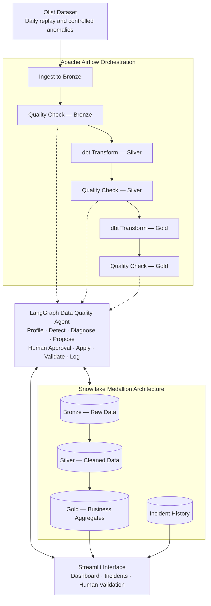

# Adaptive Data Quality Platform with Human-in-the-Loop Control

An adaptive data quality platform built with **Snowflake, dbt, Apache Airflow, and LangGraph**. The platform detects, diagnoses, and proposes corrections for data quality issues while requiring explicit human approval before any correction is applied.

Every incident and decision is recorded to ensure traceability.

**Project context:** Data Engineering Internship — Tython  
**Role:** Data Engineer Intern

---

## The Problem

Traditional data quality tests can pass while business data remains incorrect.

For example, the same city may appear under two different spellings:

| City | Sales |
|---|---:|
| `sao paulo` | 1,240 |
| `são paulo` | 890 |

A standard `not_null` or `unique` test may pass, even though the sales figures for São Paulo are split across two categories.

This illustrates a key limitation of static data quality rules: they can detect violations of known constraints, but they cannot identify every inconsistency that has not yet been defined as a rule.

**This project addresses that gap by combining data profiling, adaptive anomaly detection, AI-assisted diagnosis, and human-approved remediation.**

---

## Key Features

### 1. Adaptive Data Quality

- Profiles datasets and compares current observations with historical patterns.
- Detects schema, statistical, and semantic anomalies.
- Uses an AI agent to diagnose incidents and propose corrective actions.
- Supports incident history and dynamically generated data quality rules.
- Uses dbt tests to validate data against defined quality constraints.

### 2. Human-in-the-Loop (HITL)

Every proposed correction requires an explicit human decision before execution.

The reviewer can:

- **Approve:** authorize an approved data correction.
- **Amend the contract:** update an outdated quality rule without modifying the data.
- **Reject:** decline the proposal and record the decision.
- **Ask a question:** request additional explanation before deciding.

The validation workflow is enforced by the LangGraph execution flow rather than relying solely on a user-interface convention.

### 3. Traceability and Observability

- Records incidents, diagnoses, proposed actions, and human decisions.
- Provides a Streamlit interface for data quality monitoring and incident review.
- Maintains a history that helps reviewers understand previous decisions.

---

## Architecture



The pipeline processes data through Bronze, Silver, and Gold layers. The agent evaluates data quality at different stages and interacts with Snowflake to investigate incidents and propose remediation actions.

The Streamlit interface allows reviewers to inspect incidents, understand proposed corrections, and make informed decisions.

---

## Human Approval and Safety

Human approval is a core architectural property of the agent.

- The execution graph prevents the application step from being reached without approval.
- Amending a quality contract does not automatically authorize changes to the underlying data.
- The LLM-based diagnosis uses aggregated statistics and metadata rather than raw data rows.
- Proposed corrections are constrained by validation rules.
- Each incident is recorded for later inspection.

The agent is designed to avoid guessing unknown values. Depending on the situation, it can isolate a suspicious value, set it to `NULL`, or exclude it from an aggregation rather than inventing a replacement.

---

## Example Incident Workflow

1. A semantic inconsistency is identified in the source data.
2. The agent profiles the affected data and investigates the anomaly.
3. It proposes a correction and explains its potential impact.
4. Execution pauses while a human reviews the proposal.
5. The reviewer approves, amends, rejects, or asks a question.
6. If approved, the correction is applied and validated.
7. The incident and decision are recorded for traceability.

This workflow combines automated investigation with explicit human control.

---

## Technology Stack

| Area | Technologies |
|---|---|
| Data Warehouse | Snowflake |
| Data Architecture | Medallion — Bronze, Silver, Gold |
| Data Transformation and Testing | dbt, SQL |
| Orchestration | Apache Airflow |
| AI Agent | LangGraph, LangChain |
| Language Model | Groq, with alternative providers supported by configuration |
| Application and Observability | Streamlit |
| Agent Persistence | LangGraph checkpointing, SQLite |
| Data Processing | Python, Pandas |
| Dataset | Brazilian E-Commerce Dataset by Olist |

---

## Project Structure

```text
.
├── ingestion/       # Data ingestion scripts
├── dbt/             # Data transformations and quality tests
├── agent/           # LangGraph agent and tools
├── airflow/         # Orchestration DAGs
├── streamlit/       # Dashboard and human validation interface
├── data/            # Dataset replay and anomaly injection
├── benchmarks/      # Evaluation results
├── scripts/         # Setup, validation, and decision utilities
├── tests/           # Automated tests
└── docs/            # Architecture and technical documentation
```

---

## Getting Started

### Prerequisites

- Python 3.11 or later
- [uv](https://github.com/astral-sh/uv) for Python dependency management
- A Snowflake account
- A Groq API key or another supported language model provider
- Docker for running Airflow locally

### 1. Clone the Repository

```bash
git clone https://github.com/hodamounaouir/PFA.git
cd PFA
```

### 2. Install Dependencies

```bash
make setup
```

Configure the required environment variables in your local `.env` file. Do not commit credentials or API keys to GitHub.

### 3. Check Access

```bash
uv run python scripts/check_access.py
```

### 4. Initialize Snowflake

```bash
uv run python scripts/setup_snowflake.py
```

### 5. Run the Application

For the Streamlit interface:

```bash
uv run streamlit run streamlit/app.py
```

Additional setup may be required for the dataset, Airflow services, and Snowflake configuration. Refer to the configuration files and scripts in the repository.

---

## Limitations

- Semantic anomaly detection focuses on the anomaly patterns covered by the project and its test dataset; it is not a universal semantic understanding system.
- LLM-based diagnosis may be non-deterministic.
- Some anomalies are deliberately injected for testing, while the city-name inconsistency is present in the Olist dataset.
- The project uses proof-of-concept data volumes and requires further evaluation before production-scale deployment.
- Human review improves control but adds latency to remediation.
- Full end-to-end execution depends on the availability and configuration of external services such as Snowflake and Airflow.

---

## Future Improvements

- Quantitative benchmarking against a static-rule baseline.
- Broader anomaly detection and root-cause analysis.
- Extended data lineage and data catalog integration.
- Additional integration tests and continuous integration.
- Evaluation on larger and more diverse datasets.

---

## Author

**Hoda MOUNAOUIR**  
Engineering Student — Information Systems Engineering & Big Data

[GitHub Profile](https://github.com/hodamounaouir)

*Developed during a Data Engineering internship at Tython.*
